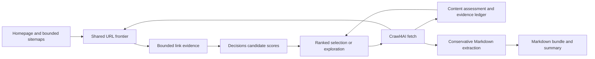

# OpenAI Decisions — adaptive discovery

The typed API adapter, budget accounting and shared discovery frontier replace keyword
scoring and use content-based categories. Stage 3 adds reviewable exports and controls.
The default CLI and Python service require `OPENAI_API_KEY`. The CLI and manual runner
load it from the shared repository-root `.env`; the CLI also accepts `--env-file`.
Existing environment values take precedence. Explicit structural mode
requires no key and makes no OpenAI calls. No paid requests or live competitor crawls are
required to review this stage.

In-memory results use schema `1.1`, carrying page assessments/selection diagnostics and
competitor `decision_usage` and optional `decision_trace`. Disk exports use schema `2.1`
with compact diagnostics and an optional `decisions.jsonl`, preserving Markdown paths.
See [migration.md](migration.md) for configuration and strict-reader changes.



In structural mode, the frontier selects by section exploration without the decision
operations. The application owns every URL choice, domain/robots check and crawl limit.

## Selection behavior

Homepage and sitemap links share one registry, deduplication policy, and page/depth limits.
Context comes from already-rendered HTML for SDK-discovered links: anchor text, heading,
location, and a text window around the anchor. No candidate probe requests are made.

Scoring runs after homepage/sitemap discovery, every five distinct attempts, or sooner when
the scored queue empties. Batches end at those checkpoints, even with higher concurrency.
At most 50 candidates per cycle are balanced across URL sections. Cached results refresh
at most once when anchor/context evidence materially changes; identical text from another
parent does not consume that refresh. Refused/invalid answers leave a candidate unscored.

BestFirst combines 70% model relevance, 20% section diversity, and 10% observed section
novelty. A section is hostname plus first path segment; diversity is `1/(1+attempts)` and
novelty is the mean assessed novelty, defaulting to 0.5. Every fifth non-homepage attempt
explores at the default 20% fraction. Other fractions use a cumulative floor schedule.
Exploration favors less-visited sections, fewer evaluations, shallower depth, and discovery
order. Robots refusals advance neither budget nor exploration schedule. Low scores never
permanently exclude an otherwise eligible URL.

Successful content is assessed after browser capacity is released. The source-linked
ledger retains eight useful, novel, distinct sampled excerpts, including text beyond shared
navigation prefixes. All scraped source content is retained regardless of its score.
Categories consume existing assessments without network access, or use `other` when absent.
BFS keeps depth/discovery ordering and skips link-scoring calls; LLM mode still assesses
its fetched pages. Structural mode uses diverse exploration and no model assessments.

Removed fields: `category_keywords`, `minimum_relevance_score`, `url_keyword_weight`, and
`title_keyword_weight`. Delete them from Python/TOML; use `selection.objective` for research
relevance or `selection.mode="structural"` for API-free selection. Existing global/per-site
override precedence remains unchanged.

## Configuration and public boundary

`SelectionConfig`, also available as `ScraperConfig.selection`, contains:

| Setting | Default |
| --- | --- |
| `mode` | `llm`; alternative `structural` |
| `model` | `gpt-6-luna` |
| `objective` | Products/services, target customers, pricing, integrations, differentiators, commercial activity, and careers/hiring; concrete company evidence for competitor analysis |
| `budget_usd` | `0.03` per competitor |
| `exploration_fraction` | `0.20` |
| `trace_enabled` | `false` |
| `timeout_seconds` | `15` per API attempt |
| `max_retries` | `2` additional attempts |
| `max_concurrency` | `2`; a shared run-wide ceiling across competitors |

Settings merge using existing defaults < global < competitor < CLI precedence, preserving
partial nested overrides. The objective accepts up to 4,000 characters. Credentials are
not configuration fields and never appear in serialized settings.

`DecisionProvider` is the SDK-independent injection interface in `interfaces.py`:

- `score_candidates(candidates)` returns a result for each supplied candidate, in input order.
  Results distinguish scored, refused, invalid, and unavailable answers. SDK score levels
  0–3 are normalized to 0–1; a refusal or invalid answer never becomes a zero score.
- `assess_content(page, ledger=())` returns independent usefulness, novelty, and category
  results. A refused/invalid question does not discard valid answers to other questions.
- `summary` returns a snapshot of mode, usage, cost estimate, and fallback events.
- `trace_records` returns defensive copies of bounded in-memory traces when enabled.
- Providers are asynchronous context managers and belong to exactly one competitor crawl.

`OpenAIDecisionProvider` owns an `AsyncOpenAI` client. An optional shared semaphore allows
different competitors to share API capacity while keeping budgets separate. The provider
never starts Crawl4AI, navigates URLs, or owns browser capacity.

Evidence models bound observations to 160 characters of anchor text, 160 of heading, and
400 of surrounding text, with at most two observations per candidate. The adapter groups
at most 50 candidates within a 48 KiB
serialized-request bound, includes at most 6,000 sampled Markdown characters, and accepts
at most eight ledger excerpts per request, each bounded to 500 characters. Gaps between
sampled page sections are marked explicitly. Full page Markdown is never changed.

## Credentials, failures, and estimated costs

The LLM provider requires `OPENAI_API_KEY` before creating its SDK client. Structural mode
requires no key, creates no SDK client, and makes no API requests. The service validates all
competitors' credential requirements before starting workers or browser/network activity.
Entry points use `load_environment` from `environment.py`, backed by `python-dotenv`,
before credential validation. Library applications call that helper explicitly or supply
their own process environment; importing models or the provider does not read `.env`.
Injected test providers bypass the environment credential check; importing configuration
reads no keys.

The SDK's automatic retries are disabled. The adapter retries connection failures/timeouts
and HTTP 408/429/500/502/503/504 only, up to the configured limit. Retry-After is honored;
delays above 30 seconds activate structural fallback instead of retrying early. Shared API
capacity is released before backoff. HTTP 401/403 raise sanitized `DecisionAccessError`
exceptions and do not silently fall back.

At the documented Decisions base rate of **$0.10 per million input tokens**, $0.03 corresponds
to 300,000 tokens. Before every attempt, the budget reserves serialized UTF-8 request bytes
plus 1,024 tokens for overhead. Returned usage replaces that reservation. Requests with
unknown usage, including interrupted requests, retain their full estimate in a separate
uncertain-usage counter. Retries reserve again; waiting for shared capacity reserves nothing.

This deliberately conservative estimate is **not a guaranteed invoice ceiling**. It does
not claim cache discounts and excludes regional/long-context adjustments. Reported input
usage can also exceed a reservation; any overrun is accounted and blocks subsequent calls.
No free-form generated explanations, summaries, or separate Responses API calls are used.

Budget exhaustion, persistent transient failures, and malformed response envelopes disable
further API requests for that provider. Its summary records a single structural fallback
event. Discovery continues structurally and records a warning, without marking fetched
pages as failed. Authentication/access errors stop the affected competitor while retaining
already-fetched pages and closing resources.

Enabled traces contain request evidence, validated answers, timing, and token accounting.
SDK exception bodies/messages, authorization headers, and API keys are not recorded.
The exporter publishes `decisions.jsonl` only when the result's effective
`selection.trace_enabled` is true. It is UTF-8 JSONL: one `DecisionTraceRecord` per
dispatched attempt, including retries. No request occurs merely to generate diagnostics.
An enabled trace with no attempts is an empty file. Without opt-in, no trace file or
reference is written, even if a custom result contains in-memory trace records.

Schema `2.1` exports `pages[].selection` (method, relevance when known, assessment
availability) and `decision_usage` (requested/effective modes, model, prompt version,
budget, request count, reported/uncertain/reserved input tokens, estimated cost, fallback
events). Custom results without these diagnostics omit them. Assessment availability
means at least one answer was valid, not that every question was answered or collection
was exhaustive. Detailed usefulness/novelty scores remain in the typed Python result;
traces expose validated rubric answers when enabled. No page content is dropped for
low usefulness or repeated evidence.

The optional `decision_trace_file` points to the fixed relative path `decisions.jsonl`.
Pages and trace are staged together, then published before `crawl_summary.json`. A trace
failure cannot publish the summary completion marker. Existing directories are refused;
use a fresh output root. See [output-layout.md](output-layout.md) for publication semantics.

Official references, verified October 18, 2026:

- [Decisions guide and pricing](https://developers.openai.com/api/docs/guides/decisions)
- [Python request/response reference](https://developers.openai.com/api/reference/python/resources/decisions/methods/create)

## Review without paid requests

From the `scraper` directory, use the existing project environment:

```powershell
uv sync --locked --offline --cache-dir .uv-cache
.\.venv\Scripts\python.exe -m pytest tests/unit/test_selection_contracts.py tests/unit/test_decision_budget.py tests/unit/test_decisions.py -q
.\.venv\Scripts\python.exe -m pytest tests/unit/test_adaptive_discovery.py tests/unit/test_adaptive_frontier.py tests/unit/test_link_context.py -q
.\.venv\Scripts\python.exe -m pytest tests/integration/test_decision_workflow.py tests/unit/test_output.py tests/unit/test_cli.py -q
.\.venv\Scripts\python.exe -m pytest tests/unit -q
```

The adapter tests use injected SDK stubs and the installed SDK with a mock HTTP transport.
They do not contact OpenAI or websites and do not need a real API key. The OpenAI SDK is
now a direct dependency (`openai>=3.26,<4`); the existing locked 3.32.0 version is retained.
The synthetic scenarios and the approval-gated live pilot procedure are documented in
[decision-validation.md](decision-validation.md). Scripted answers verify orchestration;
they do not establish real model relevance, latency, or per-website cost.
